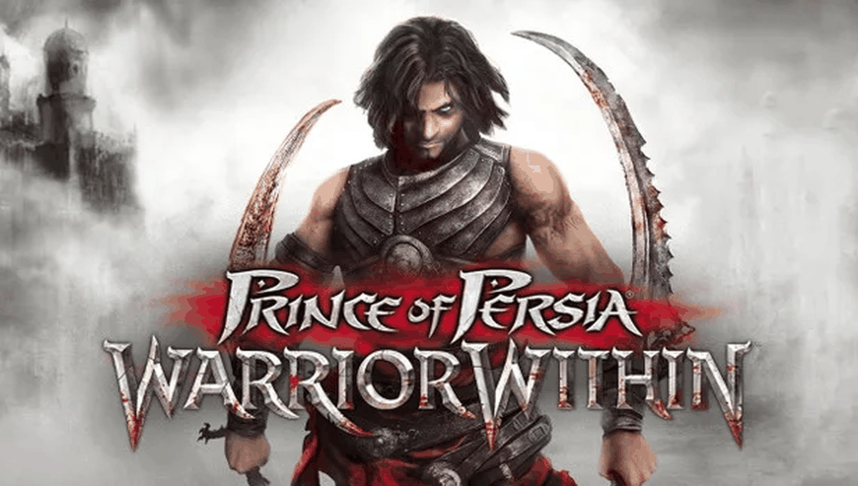

<h1 align="center">
  <br>
  Prince of Persia: Warrior Within · PS Vita Port
</h1>

<p align="center">
  <b>Native port of Prince of Persia: Warrior Within (Ubisoft / Gameloft) for PlayStation Vita and PlayStation TV.</b>
</p>

<p align="center">
  
  
  
  
  
  
</p>

<p align="center">
  <a href="#-description">Description</a> •
  <a href="#-features">Features</a> •
  <a href="#-controls">Controls</a> •
  <a href="#-installation">Installation</a> •
  <a href="#-known-issues">Known Issues</a> •
  <a href="#-building-from-source">Build</a> •
  <a href="#-credits">Credits</a>
</p>

---

## 📖 Description

An unofficial, native **iOS-to-PS Vita wrapper port** of *Prince of Persia: Warrior Within* (iOS v1.0.7, originally
developed by **Ubisoft / Gameloft**). The original 32-bit ARMv6 iOS executable runs unmodified on the Vita's CPU through a
custom **Mach-O loader**. Native Vita code replaces the Apple frameworks it depends on: Darwin libc / pthreads, a minimal
Objective-C / UIKit runtime, OpenGL ES 1.1 (on vitaGL), OpenAL, CoreAudio and the cutscene movie player (on FFmpeg).

### Loader architecture

- **Mach-O loader**: `__TEXT` / `__DATA` mapped at `0x98000000`, with rebase words from `rebase.bin` (10204),
  2112 external relocations, 53 global constructors and 372 import thunks.
- **ABI rules**: `r9` is scratch on iOS (the loader is built with `-ffixed-r9`), floats travel in integer registers
  (vitaGL is built with `SOFTFP_ABI=1`), and iOS code uses 4-byte stack alignment (realigned by `ml_align_call`).
- **FairPlay**: the executable must be decrypted (`cryptid 0`).

---

## 🎮 Status & Playability

**Status: Playable (beta) (v01.10 · v1.1.0)**

On physical hardware the game boots through the intro videos and menus into gameplay, and is fully controllable with
touch and physical buttons.

- [x] **Mach-O Loader**: `__TEXT` / `__DATA` mapped at `0x98000000`, 2112/2112 external relocations, 10204 rebase words
  (from `rebase.bin`), 53 global constructors, 372 import thunks. *Verified on console.*
- [x] **Graphics**: OpenGL ES 1.1 fixed-function → vitaGL. The 480x320 iOS framebuffer is rendered off-screen and stretched
  fullscreen to 960x544 (no black bars; touch is remapped to match). Fullscreen is the default. The original aspect
  (816x544) and the Bilinear / Sharp bilinear filters are selectable in the options menu. About 60 FPS in-game.
  *Verified on console.*
- [x] **Menus (gameswf Flash UI)**: menus, language selection and tutorials render, including stencil-masked elements.
  *Verified on console.*
- [x] **Touch & Controls**: the front touchscreen drives the on-screen virtual pad and buttons. Physical buttons and both
  analog sticks are mapped. L + R hides the on-screen controls (they still respond to touch), START pauses the game, and
  CROSS or START continue the "TOUCH THE SCREEN TO CONTINUE" screens. *Verified on console.*
- [x] **Cutscenes**: `.m4v` movies decoded in software (FFmpeg) with AAC audio. They can be skipped with Cross, Circle or
  Start. *Verified on console.*
- [x] **Audio**: OpenAL 1.1 (sound effects) and CoreAudio (streams) mapped to native Vita audio.
- [x] **Saves**: the iOS `Documents/` folder is mapped to `ux0:data/princeofpersiawarriorwithin/saves/`.
- [x] **Performance**: CPU 444 MHz, bus 222 MHz, GPU 222 MHz. VFP short-vector matrix routines replaced with native code.
- [x] **Character rendering**: CPU-skinned models (the Prince) draw correctly; client vertex arrays are copied per draw.
  *Verified on console.*
- [x] **Options menu** (Select + Start, game paused behind a translucent panel): button remap (saved to `controls.txt`),
  on-screen controls, screen size, filter, FPS counter / limit, iPhone profile (saved to `options.txt`). *Verified on
  console*, except the iPhone profile, which is not verified yet.
- [x] **Trophies**: 13 trophies + platinum, mapped from the game's own achievements (including ones already earned in an
  existing save). The trophy set installs on first launch. *Installation verified on console; individual unlocks not
  verified yet.* Requires `NoTrpDrm.suprx` (see Installation).
- [ ] **Online features (GLLive)**: not supported.

### Changelog

- **v1.1.0 (beta, second public release)**: adds an in-game options menu, on-screen control toggling, native PS Vita
  trophies and a fixed intro video. See [`RELEASE.md`](RELEASE.md).
- **v1.0 (first public release)**: the native port of the iOS v1.0.7 executable; `rebase.bin` is generated from your own
  copy of the game.

---

## ✨ Features

| Feature | Status | Notes |
| :--- | :---: | :--- |
| Boots to gameplay | ✅ | Intro videos and menus into gameplay (verified on console). |
| Graphics / renderer | ✅ | vitaGL, GLES 1.1, 960x544 fullscreen; about 60 FPS in-game (verified on console). |
| Audio & music | 🧪 | OpenAL and CoreAudio mapped to native Vita audio; not individually verified. |
| Video / cutscenes | 🟡 | Cutscenes decode in software with AAC audio and play at about 14 FPS (see Known Issues). |
| Physical buttons | ✅ | Jump, attack, grab, drop, block, pause (verified); L and Select are unverified. |
| Analog sticks / camera | ✅ | Left stick / D-Pad move; right stick camera (verified). |
| Touch screen | ✅ | Front touchscreen drives the on-screen pad and buttons (verified). |
| Button remapping / port menu | ✅ | Options menu verified on console; the iPhone profile is not verified yet. |
| Save data | 🧪 | Mapped to `ux0:data/princeofpersiawarriorwithin/saves/`. |
| Native trophies | 🟡 | Trophy set installs on first launch; individual unlocks not verified yet. |
| Languages | ✅ | Language selection screen renders (verified on console). |
| Performance | ✅ | About 60 FPS in-game (verified on console). |
| Online / IAP / ads | ➖ | GLLive online services are not supported. |
| PS TV | 🧪 | Same VPK; not tested on PS TV. |

Legend: `✅ Working (verified on console) · 🧪 Implemented, not yet verified on console · 🟡 Partial · ❌ Not working · ➖ Not applicable · ❔ Not documented yet`

---

## 🎯 Controls

| Input | Action |
| :---: | :--- |
| **Touchscreen** | Original on-screen virtual pad and buttons |
| **Left stick / D-Pad** | Move |
| **Right stick** | Camera |
| **Cross** | Jump |
| **Triangle** | Attack |
| **Circle** | Grab |
| **Square** | Drop weapon |
| **Start** | Pause / menu; in the pause menu, taps **CONTINUAR** to resume |
| **Cross** or **Start** | Continue past the "TOUCH THE SCREEN TO CONTINUE" screens (title and level loading) |
| **R** | Block |
| **L** | Time rewind (unverified) |
| **L + R** | Show / hide the on-screen touch controls (hidden controls still respond to touch) |
| **Select** | Slow motion (unverified) |
| **Select + Start** | Port options menu (game paused behind a translucent panel): button remap, on-screen controls, screen size, filter, FPS counter / limit, iPhone profile (the iPhone profile is not verified) |

> [!TIP]
> Buttons can be remapped with `ux0:data/princeofpersiawarriorwithin/controls.txt`, one `BUTTON = ACTION` per line.
> Buttons: `CROSS SQUARE TRIANGLE CIRCLE L1 R1 SELECT START` (`L` and `R` are also accepted). Actions: `JUMP ATTACK GRAB
> DROP BLOCK REWIND SLOWMO MENU`, or a raw input bit such as `BIT5`. The D-pad is not remappable.
>
> ```
> R1 = BLOCK
> L1 = REWIND
> ```
>
> Blocking is always available through the on-screen shield button.
>
> The same changes can be made in-game: **Select + Start** opens the options menu, whose button editor writes `controls.txt`.
> Its other settings are saved to `ux0:data/princeofpersiawarriorwithin/options.txt` (`filter=bilinear|sharp`,
> `stretch=1|0`, `show_fps=0|1`, `fps_cap=0|30`, `hud_hidden=1|0`, `device=iPhone1,1|iPhone1,2|iPod2,1|iPhone2,1|iPod3,1`).
> `device` is the iPhone profile the game sees (iPhone 2G, iPhone 3G, iPod touch 2G, iPhone 3GS, iPod touch 3G; default 3GS);
> it applies after a restart. *Options menu verified on console; the iPhone profile is not verified yet.*

### Port options (Select + Start)

Hold **Select + Start** in game to open the options menu. The game stays paused behind a translucent panel. **Up / Down**
moves between rows, **X** changes the selected row (or assigns a new button), **Left / Right** cycles a setting,
**Triangle** clears a button, and **Circle** or **Start** closes the menu and saves.

There is no MSAA row and no rotation row in this port's menu.

---

## 🏆 Trophies

The port has **13 trophies + platinum**, mapped from the game's own achievements. The trophy set installs on the first launch. It needs `NoTrpDrm.suprx` under `*main` in `ur0:tai/config.txt` (reboot after
editing). Without the plugin the game runs normally with trophies off. Progress from an existing save counts: earned
achievements are mapped as well.

On the first launch with `NoTrpDrm` the screen may stay black for a few seconds while the trophies install. Do not close the game.
The trophy set is inside the VPK (`sce_sys`), so the whole VPK must be installed.

---

## 📋 Prerequisites

1. A PS Vita / PS TV running Custom Firmware (**Enso 3.60 / 3.65** recommended).
2. **kubridge** in `ur0:tai/config.txt`:
   ```ini
   *KERNEL
   ur0:tai/kubridge.skprx
   ```
3. **libshacccg.suprx** in `ur0:data/` (extract it with **ShaRKBR33D**).
4. A FairPlay-decrypted **Prince of Persia - Warrior Within v1.0.7** `.ipa` (`cryptid 0`; encrypted binaries crash at load).
5. *(Optional)* `NoTrpDrm.suprx` in `ur0:tai/` for trophies.

---

## 📦 Installation

1. **Game files**: unzip the decrypted `.ipa` and take the `Payload/*.app/` folder.
2. **Generate `rebase.bin`** from the executable:
   ```bash
   python3 -I tools/macho_prep.py Payload/<App>.app/POP rebase.bin
   ```
3. **Copy to the Vita** (`ux0:data/princeofpersiawarriorwithin/`):
   ```
   ux0:data/princeofpersiawarriorwithin/
     game_app/       contents of the .app folder (POP executable, .big/.MGM data, .m4v movies...)
     rebase.bin      rebase table generated in step 2
     controls.txt    optional — custom button mapping (see Controls)
     options.txt     optional — screen, filter and FPS settings (see Options)
     saves/          created automatically — your save games
     logs/           created automatically — one log per run
   ```
   `tools/stage_data.sh` builds this layout from the `.app` folder.
4. **Install the VPK**: install the full `princeofpersiawarriorwithin.vpk` (Title ID `PSVPOPWW1`, version `01.10`) with
   VitaShell. The trophy set is inside the VPK, so the whole file must be installed.
5. **Trophies (optional)**: add `ur0:tai/NoTrpDrm.suprx` under `*main` in `ur0:tai/config.txt`, then reboot the Vita.

### ⚙️ Options

The settings file `ux0:data/princeofpersiawarriorwithin/options.txt` can be edited by hand:
`filter=bilinear|sharp`, `stretch=0|1` (1 = full screen), `show_fps=0|1`, `fps_cap=0|30`, `hud_hidden=0|1`,
`device=iPhone1,1|iPhone1,2|iPod2,1|iPhone2,1|iPod3,1`.

| Row | Values | Notes |
| :--- | :--- | :--- |
| One row per action (Jump, Attack, Grab, Drop, Block, Rewind, Slow motion, Menu) | the button(s) bound to it | **X**, then press the new button. If another action already uses that button, the two actions swap. **Triangle** leaves the action with no button. **Start** cancels the capture. Saved to `controls.txt`. |
| On-screen controls (L+R) | SHOWN / HIDDEN | Same as **L+R** in game. Hidden controls keep responding to touch. |
| Screen size | FULL SCREEN / ORIGINAL ASPECT | Default: full screen (960×544). Original aspect is 816×544 with side bars. |
| Screen filter | BILINEAR (SMOOTH) / SHARP BILINEAR | Default: bilinear. |
| FPS counter | OFF / ON | Top-left corner of the screen. |
| FPS limit | OFF (GAME) / 30 FPS | |
| iPhone profile | iPhone 2G, iPhone 3G, iPod touch 2G, iPhone 3GS, iPod touch 3G | Default: iPhone 3GS. Applies after restarting the game. Not verified on console yet. |

---

## 🐛 Known Issues

- **Cutscene frame rate**: movies are decoded in software (the hardware decoder fails to initialize) and play at about 14 FPS.
- **L / Select mappings** have not been confirmed in game yet. L and R act after being held for 3 frames (about 50 ms), so pressing
  L + R together never triggers a rewind or block.
- **Trophies**: the trophy set installs on first launch, but individual unlocks are not verified on console yet. Requires
  `NoTrpDrm.suprx`.
- **iPhone profile** (options menu): not verified on console. In this game it only affects a menu flag, not graphics.
- **UBISOFT / UBIMTL / LOGORP videos**: these do not exist in the iOS IPA either, so their absence is expected and not a bug.
- **Online features disabled**: the GLLive online services are not supported.
- **Logs and crash dumps**: runtime logs are in `ux0:data/princeofpersiawarriorwithin/logs/`. Crash dumps are written by
  the system to `ux0:data/`, not to the game folder.

---

## 🔨 Building from Source

### Prerequisites

- [VitaSDK](https://vitasdk.org/) **softfp** toolchain (`$VITASDK`), since iOS code passes floats in integer registers.
  vitaGL is vendored in `vendor/vitaGL` and built automatically with `SOFTFP_ABI=1`.
- CMake 3.14+, Python 3 (for the tools).
- Your own decrypted `.ipa`, unpacked locally (`game_app` symlink → the `.app` folder). It is never committed (`.gitignore`).

### Compilation Commands

```bash
cd Prince-of-Persia-Warrior-Within-vita
./build.sh            # Release -> build/princeofpersiawarriorwithin.vpk
./build.sh Debug      # adds loader debug logging
./build.sh clean      # full rebuild
```

### Deploy & Debug

```bash
tools/stage_data.sh                               # build ux0_data/princeofpersiawarriorwithin/
python3 -I tools/deploy_data.py --ip <VITA_IP>    # incremental FTP upload (VitaShell FTP)
python3 -I tools/deploy_data.py --ip <VITA_IP> --logs   # fetch the run logs
```

Guest addresses in logs and crash dumps are `0x98000000 + Mach-O vmaddr` (minus `0x1000` for the file offset of `__TEXT`).
Architecture, ABI rules (`r9`, softfp, 4-byte stack alignment) and progress notes:
[`PORTING_PLAN.md`](PORTING_PLAN.md) and [`port_progress.md`](port_progress.md).

---

## 📁 Project Structure

- `source/`: native loader (Mach-O, ABI glue, Darwin, ObjC / UIKit runtime, GLES, audio, movies, input, trophies, options).
- `tools/`: staging and deploy scripts (`stage_data.sh`, `macho_prep.py`, `deploy_data.py`).
- `vendor/vitaGL/`: vitaGL built from source (`SOFTFP_ABI=1`).
- `extras/livearea/`: LiveArea assets (`pic0.png` is the banner).
- `PORTING_PLAN.md`: living plan: engine findings, every patch applied to the `.so` and why.
- `port_progress.md`: bug-by-bug diagnosis log, one confirmed bug at a time.
- `RELEASE.md`: release checklist and release text.

---

## 📜 Disclaimer

**Prince of Persia** and **Prince of Persia: Warrior Within** are registered trademarks of **Ubisoft Entertainment**. The work
presented in this repository is unofficial and is not produced, endorsed, or sanctioned by Ubisoft, Gameloft or any affiliated entities.

This software does NOT contain original game code, binaries, copyrighted graphics, or game assets. The authors do not promote or
condone piracy in any way. To play, you must provide your own legally obtained, **decrypted** copy of the iOS game (`.ipa`, v1.0.7).

---

## ☕ Support My Work

This project is **free** and will stay free. If you enjoy it, a tip from **$1** helps me keep porting games to the PS Vita:

<p align="center">
  <a href="https://ko-fi.com/metalsyntax"></a>
</p>

- **Ko-fi:** [ko-fi.com/metalsyntax](https://ko-fi.com/metalsyntax)
- **PayPal:** [paypal.me/MetalSyntax](https://paypal.me/MetalSyntax)
- **Bitcoin (BTC):** `133HdCsaWxdjTfmwpgGVykByhNBV338uRc`

**Ko-fi supporters get:**
- **Early access** to new ports before their public release (test builds of upcoming projects).
- **Data preparation scripts and step-by-step guides** to set up your own game files for each new port.
- A say in which games I port next.

> Game files are never distributed. You always need your own legally obtained copy of the game.

---

## 👥 Credits

- **Prince of Persia: Warrior Within** is intellectual property of **Ubisoft Entertainment**, built on Ubisoft's Jade engine.
  The iOS version was published by Gameloft.
- **MetalSyntax**: this port.
- **vitaGL** graphics library by [Rinnegatamante](https://github.com/Rinnegatamante/vitaGL).
- **kubridge** plugin by [Bythos](https://github.com/bythos14/kubridge).
- **so-loader** architecture and [soloader-boilerplate](https://github.com/Rinnegatamante/soloader-boilerplate) by Rinnegatamante (inspiration for this Mach-O loader).
- **FFmpeg** for cutscene decoding, **OpenAL Soft** for audio (VitaSDK packages).
- The PS Vita homebrew and porting community.

---

## 📄 License

<!-- TODO: no LICENSE file in this repository. Add the license text and holder before publishing. -->
