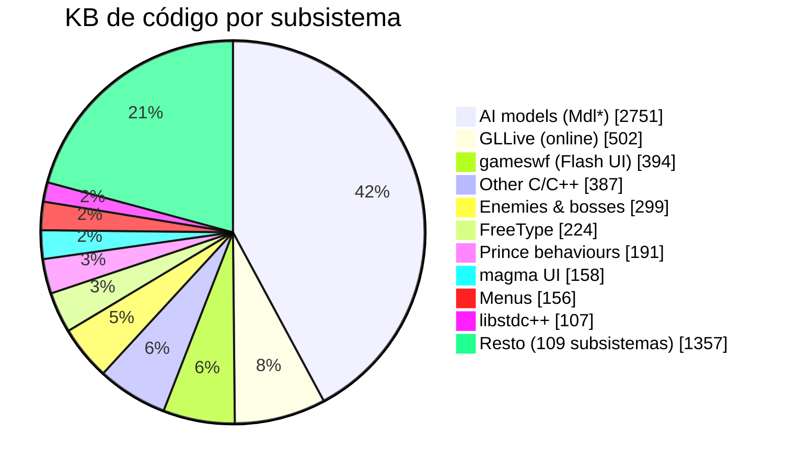

# Estado de decompilación / recompilación

<!-- Generado por tools/decomp_map.py (hook pre-commit). No editar a mano. -->

Ejecutable iOS `POP` (ARMv6, motor Jade), `__TEXT,__text` `0x00002678`–`0x00662fd4`: **17867 funciones, 6530 KB**. La Vita ejecuta el ARM original vía el loader Mach-O; "nativo" = reescrito en C y compilado para la Vita.

| Etapa | Funciones | % bytes | Progreso |
|---|--:|--:|---|
| Pseudo-C (Ghidra) | 17867 | 100.00 % | `████████████████████` |
| Con nombre original | 17836 | 99.98 % | `████████████████████` |
| Recompilado nativo (C para Vita) | 12 | 0.04 % | `░░░░░░░░░░░░░░░░░░░░` |
| Fuente reconstruida (`docs/decomp_status.tsv`) | 0 | 0.00 % | `░░░░░░░░░░░░░░░░░░░░` |

## Código por subsistema

| Subsistema | Funcs | KB | Nativo | % |
|---|--:|--:|---|--:|
| AI models (Mdl*) | 4259 | 2751 | `░░░░░░░░░░░░` | 0.0 |
| GLLive (online) | 1393 | 502 | `░░░░░░░░░░░░` | 0.0 |
| gameswf (Flash UI) | 1944 | 394 | `░░░░░░░░░░░░` | 0.0 |
| Other C/C++ | 2130 | 387 | `░░░░░░░░░░░░` | 0.3 |
| Enemies & bosses | 291 | 299 | `░░░░░░░░░░░░` | 0.0 |
| FreeType | 514 | 224 | `░░░░░░░░░░░░` | 0.0 |
| Prince behaviours | 92 | 191 | `░░░░░░░░░░░░` | 0.0 |
| magma UI | 812 | 158 | `░░░░░░░░░░░░` | 0.0 |
| Menus | 640 | 156 | `░░░░░░░░░░░░` | 0.0 |
| libstdc++ | 998 | 107 | `░░░░░░░░░░░░` | 0.0 |
| Jade IO | 148 | 103 | `░░░░░░░░░░░░` | 0.0 |
| Jade GAO | 296 | 103 | `░░░░░░░░░░░░` | 0.0 |
| Jade GFX · Effects | 178 | 78 | `░░░░░░░░░░░░` | 0.0 |
| Jade COL · Collision | 107 | 78 | `░░░░░░░░░░░░` | 0.0 |
| ubi (Ubisoft lib) | 418 | 76 | `░░░░░░░░░░░░` | 0.0 |
| Jade AI · AI scripting | 694 | 74 | `░░░░░░░░░░░░` | 0.0 |
| Sound engine (C++) | 398 | 73 | `░░░░░░░░░░░░` | 0.0 |
| iOS ObjC layer | 174 | 59 | `░░░░░░░░░░░░` | 0.0 |
| Jade SND · Sound | 392 | 40 | `░░░░░░░░░░░░` | 0.0 |
| Tutorial | 70 | 40 | `░░░░░░░░░░░░` | 0.0 |
| Camera | 68 | 38 | `░░░░░░░░░░░░` | 0.0 |
| Jade OBJ · Game objects | 89 | 35 | `░░░░░░░░░░░░` | 0.0 |
| Jade PAG · Particles | 49 | 34 | `░░░░░░░░░░░░` | 0.0 |
| Mac/iOS platform layer | 160 | 29 | `░░░░░░░░░░░░` | 0.0 |
| Jade EVE · Event tracks | 93 | 28 | `░░░░░░░░░░░░` | 0.0 |
| Jade WOR · World | 86 | 25 | `░░░░░░░░░░░░` | 0.0 |
| Jade MAT · Materials | 62 | 24 | `░░░░░░░░░░░░` | 0.0 |
| Jade GEO · Geometry | 53 | 23 | `░░░░░░░░░░░░` | 0.0 |
| Jade INT | 62 | 23 | `░░░░░░░░░░░░` | 0.0 |
| Jade ANI · Animation | 58 | 23 | `░░░░░░░░░░░░` | 0.0 |
| Jade TEX · Textures | 81 | 20 | `░░░░░░░░░░░░` | 0.0 |
| Jade MATH · Math | 95 | 20 | `░░░░░░░░░░░░` | 0.0 |
| Jade STR · Text/strings | 55 | 18 | `░░░░░░░░░░░░` | 0.0 |
| VCR (replay) | 48 | 17 | `░░░░░░░░░░░░` | 0.0 |
| Jade LIGHT · Lights | 42 | 17 | `░░░░░░░░░░░░` | 0.0 |
| Jade DARE | 60 | 13 | `░░░░░░░░░░░░` | 0.0 |
| Jade GRID | 15 | 12 | `░░░░░░░░░░░░` | 0.0 |
| zlib | 10 | 10 | `░░░░░░░░░░░░` | 0.0 |
| Jade AMIX | 31 | 10 | `░░░░░░░░░░░░` | 0.0 |
| Jade SFX | 17 | 10 | `░░░░░░░░░░░░` | 0.0 |
| Jade WATER3D | 12 | 10 | `░░░░░░░░░░░░` | 0.0 |
| Jade DYN · Dynamics | 43 | 9 | `░░░░░░░░░░░░` | 0.0 |
| Jade MACHD | 29 | 8 | `░░░░░░░░░░░░` | 0.0 |
| Jade SDW | 9 | 7 | `░░░░░░░░░░░░` | 0.0 |
| Jade LOA · Loader | 37 | 7 | `░░░░░░░░░░░░` | 0.0 |
| Jade BIG · Bigfile | 23 | 7 | `░░░░░░░░░░░░` | 0.0 |
| Jade MDF · Modifiers | 20 | 6 | `░░░░░░░░░░░░` | 0.0 |
| Jade ENG · Engine | 14 | 5 | `░░░░░░░░░░░░` | 0.0 |
| Jade REC | 9 | 5 | `░░░░░░░░░░░░` | 0.0 |
| Jade ACT | 9 | 5 | `░░░░░░░░░░░░` | 0.0 |
| Jade SOFT | 18 | 4 | `░░░░░░░░░░░░` | 0.0 |
| Jade GDI · Graphics device | 14 | 4 | `░░░░░░░░░░░░` | 0.0 |
| Jade BDF | 5 | 4 | `░░░░░░░░░░░░` | 0.0 |
| Jade GRI | 13 | 3 | `░░░░░░░░░░░░` | 0.0 |
| Jade TAB | 27 | 3 | `░░░░░░░░░░░░` | 0.0 |
| Jade FNT | 5 | 3 | `░░░░░░░░░░░░` | 0.0 |
| Jade GP065 | 6 | 3 | `░░░░░░░░░░░░` | 0.0 |
| Jade HG | 8 | 2 | `░░░░░░░░░░░░` | 0.0 |
| Jade GP710 | 6 | 2 | `░░░░░░░░░░░░` | 0.0 |
| Jade TEXPRO | 12 | 2 | `░░░░░░░░░░░░` | 0.0 |
| Jade XBL | 6 | 2 | `░░░░░░░░░░░░` | 0.0 |
| Jade WAY · Waypoints | 14 | 2 | `░░░░░░░░░░░░` | 0.0 |
| Jade CAM · Camera | 11 | 2 | `░░░░░░░░░░░░` | 0.0 |
| Jade TEXT | 11 | 2 | `░░░░░░░░░░░░` | 0.0 |
| Jade GRO | 21 | 2 | `░░░░░░░░░░░░` | 0.0 |
| Jade INO · Input | 29 | 2 | `███████▏░░░░` | 59.5 |
| Jade GP020 | 5 | 2 | `░░░░░░░░░░░░` | 0.0 |
| Jade GP010 | 5 | 2 | `░░░░░░░░░░░░` | 0.0 |
| Jade GP055 | 4 | 2 | `░░░░░░░░░░░░` | 0.0 |
| Jade PROTEX | 5 | 2 | `░░░░░░░░░░░░` | 0.0 |
| Jade VIDEO | 13 | 1 | `░░░░░░░░░░░░` | 0.0 |
| Jade GP105 | 5 | 1 | `░░░░░░░░░░░░` | 0.0 |
| Jade GP045 | 5 | 1 | `░░░░░░░░░░░░` | 0.0 |
| Jade GP205 | 5 | 1 | `░░░░░░░░░░░░` | 0.0 |
| Jade GP115 | 5 | 1 | `░░░░░░░░░░░░` | 0.0 |
| Jade GP040 | 4 | 1 | `░░░░░░░░░░░░` | 0.0 |
| Jade SE | 4 | 1 | `░░░░░░░░░░░░` | 0.0 |
| Jade GP085 | 4 | 1 | `░░░░░░░░░░░░` | 0.0 |
| Jade GP615 | 5 | 1 | `░░░░░░░░░░░░` | 0.0 |
| Jade GP415 | 5 | 1 | `░░░░░░░░░░░░` | 0.0 |
| Jade GP070 | 5 | 1 | `░░░░░░░░░░░░` | 0.0 |
| Jade GP605 | 5 | 1 | `░░░░░░░░░░░░` | 0.0 |
| Jade GP715 | 5 | 1 | `░░░░░░░░░░░░` | 0.0 |
| Jade GP210 | 5 | 1 | `░░░░░░░░░░░░` | 0.0 |
| Jade GP035 | 5 | 1 | `░░░░░░░░░░░░` | 0.0 |
| Jade GP400 | 5 | 1 | `░░░░░░░░░░░░` | 0.0 |
| Jade PCF | 3 | 1 | `░░░░░░░░░░░░` | 0.0 |
| Jade EOT | 8 | 1 | `░░░░░░░░░░░░` | 0.0 |
| Jade TIM | 6 | 1 | `░░░░░░░░░░░░` | 0.0 |
| Jade GP410 | 4 | 1 | `░░░░░░░░░░░░` | 0.0 |
| Jade GP125 | 4 | 1 | `░░░░░░░░░░░░` | 0.0 |
| Jade COLOR | 5 | 1 | `░░░░░░░░░░░░` | 0.0 |
| Jade GP235 | 4 | 1 | `░░░░░░░░░░░░` | 0.0 |
| Jade GP425 | 4 | 1 | `░░░░░░░░░░░░` | 0.0 |
| Jade GP075 | 4 | 1 | `░░░░░░░░░░░░` | 0.0 |
| Jade GP215 | 4 | 1 | `░░░░░░░░░░░░` | 0.0 |
| Jade NAVMAP | 5 | 1 | `░░░░░░░░░░░░` | 0.0 |
| Jade GP230 | 4 | 1 | `░░░░░░░░░░░░` | 0.0 |
| Jade GP120 | 4 | 1 | `░░░░░░░░░░░░` | 0.0 |
| Jade GP100 | 4 | 1 | `░░░░░░░░░░░░` | 0.0 |
| Jade GP110 | 4 | 1 | `░░░░░░░░░░░░` | 0.0 |
| Jade BAS | 11 | 1 | `░░░░░░░░░░░░` | 0.0 |
| Jade PRO | 8 | 1 | `░░░░░░░░░░░░` | 0.0 |
| Jade GRP | 6 | 1 | `░░░░░░░░░░░░` | 0.0 |
| Jade FUN | 31 | 1 | `░░░░░░░░░░░░` | 0.0 |
| Jade HD | 17 | 0 | `░░░░░░░░░░░░` | 0.0 |
| Jade PS | 3 | 0 | `░░░░░░░░░░░░` | 0.0 |
| Jade GEN | 6 | 0 | `░░░░░░░░░░░░` | 0.0 |
| Jade FOG | 1 | 0 | `░░░░░░░░░░░░` | 0.0 |
| Jade XMEN | 2 | 0 | `░░░░░░░░░░░░` | 0.0 |
| Jade BEAMGEN | 2 | 0 | `░░░░░░░░░░░░` | 0.0 |
| Jade ADPCM | 1 | 0 | `░░░░░░░░░░░░` | 0.0 |
| Jade TIME | 1 | 0 | `░░░░░░░░░░░░` | 0.0 |
| Jade OBJMY | 1 | 0 | `░░░░░░░░░░░░` | 0.0 |
| Jade ERR | 7 | 0 | `░░░░░░░░░░░░` | 0.0 |
| Jade WIND | 2 | 0 | `░░░░░░░░░░░░` | 0.0 |
| Jade SM | 1 | 0 | `░░░░░░░░░░░░` | 0.0 |
| Jade AI2C | 1 | 0 | `░░░░░░░░░░░░` | 0.0 |
| Jade MEM | 2 | 0 | `░░░░░░░░░░░░` | 0.0 |

## Funciones nativas / reconstruidas

| Dirección | Función | Subsistema | Implementación |
|---|---|---|---|
| `0x00008fb8` | `StartMovieOnMainThread` | Other C/C++ | patch.c: hook_StartMovieOnMainThread |
| `0x0002bfc8` | `StopMovie` | Other C/C++ | patch.c: hook_StopMovie |
| `0x0002c028` | `PlayMovie` | Other C/C++ | patch.c: hook_PlayMovie |
| `0x0002c058` | `LoadMovie` | Other C/C++ | patch.c: hook_LoadMovie |
| `0x0002cf68` | `IsMoviePlaying` | Other C/C++ | patch.c: hook_IsMoviePlaying |
| `0x000aaba8` | `INO_Joystick_Update` | Jade INO · Input | patch.c: hook_INO_Joystick_Update |
| `0x000ab044` | `INO_Joystick_GetButtonX` | Jade INO · Input | patch.c: hook_INO_Joystick_GetButtonX |
| `0x000ab080` | `INO_Joystick_GetButtonY` | Jade INO · Input | patch.c: hook_INO_Joystick_GetButtonY |
| `0x000ab234` | `INO_Joystick_Move` | Jade INO · Input | patch.c: hook_INO_Joystick_Move |
| `0x000af1b8` | `Matrix4Mul(float const*, float const*, float*)` | Other C/C++ | patch.c: hook_Matrix4Mul |
| `0x000af23c` | `Matrix3Mul(float const*, float const*, float*)` | Other C/C++ | patch.c: hook_Matrix3Mul |
| `0x000af2a8` | `Matrix4Vector3Mul(float const*, float const*, float*)` | Other C/C++ | patch.c: hook_Matrix4Vector3Mul |

## Imports del loader

464 símbolos: **346** implementados, **118** stubs, **0** clases ObjC del despachador, **0** sin resolver.

`██████████████████████▍░░░░░░░`

Stubs y sin resolver

- `_AudioSessionInitialize` → ok
- `_AudioSessionSetActive` → ok
- `_AudioSessionSetProperty` → ok
- `_CFAbsoluteTimeGetDayOfWeek` → cf_CFAbsoluteTimeGetDayOfWeek
- `_CFAbsoluteTimeGetGregorianDate` → cf_CFAbsoluteTimeGetGregorianDate
- `_CFAllocatorGetDefault` → cf_CFAllocatorGetDefault
- `_CFBundleCopyBundleURL` → cf_CFBundleCopyBundleURL
- `_CFBundleGetMainBundle` → cf_CFBundleGetMainBundle
- `_CFRelease` → cf_CFRelease
- `_CFTimeZoneCopySystem` → cf_CFTimeZoneCopySystem
- `_CGContextDrawImage` → cg_CGContextDrawImage
- `_CGContextFillRect` → cg_CGContextFillRect
- `_CGContextScaleCTM` → cg_CGContextScaleCTM
- `_CGContextSetRGBFillColor` → cg_CGContextSetRGBFillColor
- `_CGContextTranslateCTM` → cg_CGContextTranslateCTM
- `_CGImageGetColorSpace` → cg_CGImageGetColorSpace
- `_CGImageGetHeight` → cg_CGImageGetHeight
- `_CGImageGetWidth` → cg_CGImageGetWidth
- `_UIGraphicsBeginImageContext` → ui_UIGraphicsBeginImageContext
- `_UIGraphicsEndImageContext` → ui_UIGraphicsEndImageContext
- `_UIGraphicsGetCurrentContext` → ui_UIGraphicsGetCurrentContext
- `_UIGraphicsGetImageFromCurrentImageContext` → ui_UIGraphicsGetImageFromCurrentImageContext
- `_UIImageJPEGRepresentation` → ui_UIImageJPEGRepresentation
- `_UIImagePNGRepresentation` → ui_UIImagePNGRepresentation
- `__Unwind_SjLj_Register` → d_sjlj_noop
- `__Unwind_SjLj_Resume` → d_sjlj_resume
- `__Unwind_SjLj_Unregister` → d_sjlj_noop
- `___cmpdi2` → ll_cmp
- `___cxa_allocate_exception` → d_cxa_allocate_exception
- `___cxa_atexit` → d___cxa_atexit
- `___cxa_begin_catch` → d_cxa_begin_catch
- `___cxa_call_unexpected` → d_cxa_call_unexpected
- `___cxa_end_catch` → d_cxa_end_catch
- `___cxa_free_exception` → d_cxa_free_exception
- `___cxa_guard_abort` → d_cxa_guard_abort
- `___cxa_guard_acquire` → d___cxa_guard_acquire
- `___cxa_guard_release` → d___cxa_guard_release
- `___cxa_pure_virtual` → d___cxa_pure_virtual
- `___cxa_rethrow` → d_cxa_rethrow
- `___divdi3` → ll_div
- `___divsi3` → i_div
- `___dynamic_cast` → d_dynamic_cast
- `___error` → d___error
- `___fixdfdi` → d_toll
- `___fixsfdi` → f_toll
- `___fixunssfdi` → f_toull
- `___floatdidf` → ll_tod
- `___floatdisf` → ll_tof
- `___gxx_personality_sj0` → d_sjlj_noop
- `___modsi3` → i_mod
- `___objc_personality_v0` → d_sjlj_noop
- `___tolower` → d_tolower
- `___toupper` → d_toupper
- `___udivdi3` → ull_div
- `___udivsi3` → u_div
- `___umodsi3` → u_mod
- `_accept` → d_net_fail
- `_acos` → m_acos
- `_acosf` → m_acosf
- `_asin` → m_asin
- `_asinf` → m_asinf
- `_atan` → m_atan
- `_atan2` → m_atan2
- `_atanf` → m_atanf
- `_bind` → d_net_fail
- `_ceil` → m_ceil
- `_ceilf` → m_ceilf
- `_connect` → d_net_fail
- `_cos` → m_cos
- `_cosf` → m_cosf
- `_exp` → m_exp
- `_expf` → m_expf
- `_fcntl` → d_net_fail
- `_floor` → m_floor
- `_floorf` → m_floorf
- `_fmax` → m_fmax
- `_fmin` → m_fmin
- `_fmod` → m_fmod
- `_gethostbyname` → d_gethostbyname
- `_gethostname` → d_gethostname
- `_getprotobyname` → d_getprotobyname
- `_getsockname` → d_getsockname
- `_getsockopt` → d_getsockopt
- `_glBindFramebufferOES` → g_glBindFramebufferOES
- `_glBindRenderbufferOES` → g_glNoop
- `_glDeleteFramebuffersOES` → g_glNoop
- `_glDeleteRenderbuffersOES` → g_glNoop
- `_glFramebufferRenderbufferOES` → g_glNoop
- `_glRenderbufferStorageOES` → g_glNoop
- `_inet_addr` → d_net_fail
- `_inet_ntoa` → d_inet_ntoa
- `_ioctl` → d_ioctl
- `_listen` → d_net_fail
- `_log` → m_log
- `_log10f` → m_log10f
- `_logf` → m_logf
- `_objc_begin_catch` → objc_begin_catch
- `_objc_end_catch` → objc_end_catch
- `_objc_enumerationMutation` → objc_enumerationMutation
- `_pow` → m_pow
- `_pthread_cancel` → d_pthread_cancel
- `_pthread_mutexattr_destroy` → d_pthread_mutexattr_destroy
- `_pthread_setcanceltype` → d_pthread_setcanceltype
- `_pthread_testcancel` → d_pthread_testcancel
- `_recv` → d_net_fail
- `_recvfrom` → d_recvfrom
- `_roundf` → m_roundf
- `_select` → d_select
- `_send` → d_net_fail
- `_sendto` → d_sendto
- `_setsockopt` → d_net_fail
- `_sigaction` → d_sigaction
- `_sin` → m_sin
- `_sinf` → m_sinf
- `_socket` → d_net_fail
- `_tan` → m_tan
- `_tanf` → m_tanf
- `_wprintf` → d_wprintf

## Selectores ObjC a clases del sistema

220 selectores: **92** implementados en `source/objc.c`, **128** devuelven nil.

`████████████▌░░░░░░░░░░░░░░░░░`

Sin implementar

`CGImage` `ResizeImage:iWidth:iHeight:` `UIImageToPNGBuffer:ppBuf:iLenght:` `URL` `URLWithString:` `absoluteString` `addObject:` `addObserver:selector:name:object:` `addTarget:action:forControlEvents:` `allTouches` `allowsImageEditing` `alpha` `appendData:` `arrayWithObjects:` `backgroundColor` `becomeFirstResponder` `beginGeneratingDeviceOrientationNotifications` `bringSubviewToFront:` `buttonWithType:` `bytes` `class` `clickBack` `clickOK` `colorWithRed:green:blue:alpha:` `componentsSeparatedByString:` `copyItemAtPath:toPath:error:` `data` `dataUsingEncoding:allowLossyConversion:` `dictionaryWithObjects:forKeys:` `didResizeEAGLSurfaceForView:` `dismissModalViewControllerAnimated:` `endInput` `enumeratorAtPath:` `fileURLWithPath:` `font` `goBack` `goForward` `grayColor` `imageNamed:` `imageWithData:` `initWithActivityIndicatorStyle:` `initWithArray:` `initWithBytes:length:` `initWithContentURL:` `initWithContentsOfURL:` `initWithData:encoding:` `initWithNibName:bundle:` `initWithRequest:delegate:` `initWithTitle:message:delegate:cancelButtonTitle:otherButtonTitles:` `invalidate` `isHidden` `isMemberOfClass:` `isSecureTextEntry` `isSourceTypeAvailable:` `isUserInteractionEnabled` `isValid` `keyWindow` `keyboardType` `lineBreakMode` `loadHTMLString:baseURL:` `loadRequest:` `localizedDescription` `locationInView:` `nextObject` `numberOfLines` `openURL:` `orangeColor` `orientation` `phase` `play` `removeFromSuperview` `removeObserver:name:object:` `requestWithURL:` `requestWithURL:cachePolicy:timeoutInterval:` `resignFirstResponder` `sendActionsForControlEvents:` `sendSynchronousRequest:returningResponse:error:` `setAdjustsFontSizeToFitWidth:` `setAllowsImageEditing:` `setBorderStyle:` `setBounds:` `setCenter:` `setContentMode:` `setEnabled:` `setFont:` `setHTTPBody:` `setHTTPMethod:` `setImage:` `setImage:forState:` `setKeyboardType:` `setLength:` `setLineBreakMode:` `setMovieControlMode:` `setNetworkActivityIndicatorVisible:` `setNumberOfLines:` `setScalingMode:` `setSecureTextEntry:` `setSourceType:` `setStatusBarHidden:animated:` `setStatusBarOrientation:` `setTag:` `setText:` `setTextAlignment:` `setTextColor:` `setTitle:forState:` `setURL:` `setView:` `show` `size` `sourceType` `startAnimating` `startPhotoLibraryPiker:` `statusBarOrientation` `statusCode` `stop` `stopAnimating` `stringByEvaluatingJavaScriptFromString:` `subviews` `superview` `text` `transform` `userInfo` `valueForKey:` `viewDidLoad` `window` `x` `y` `z`

